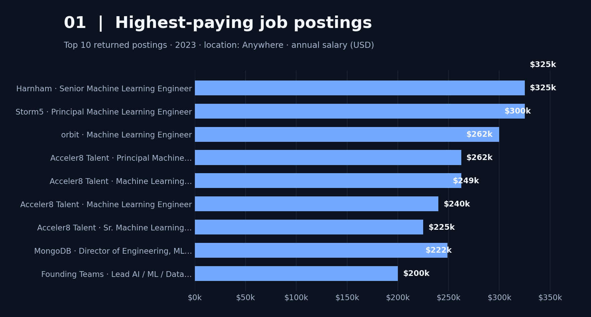
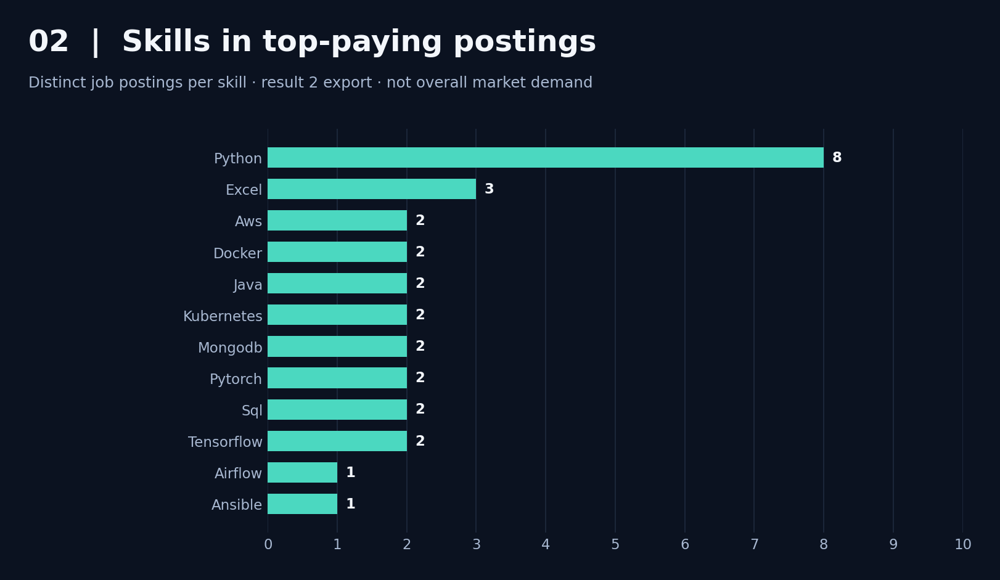
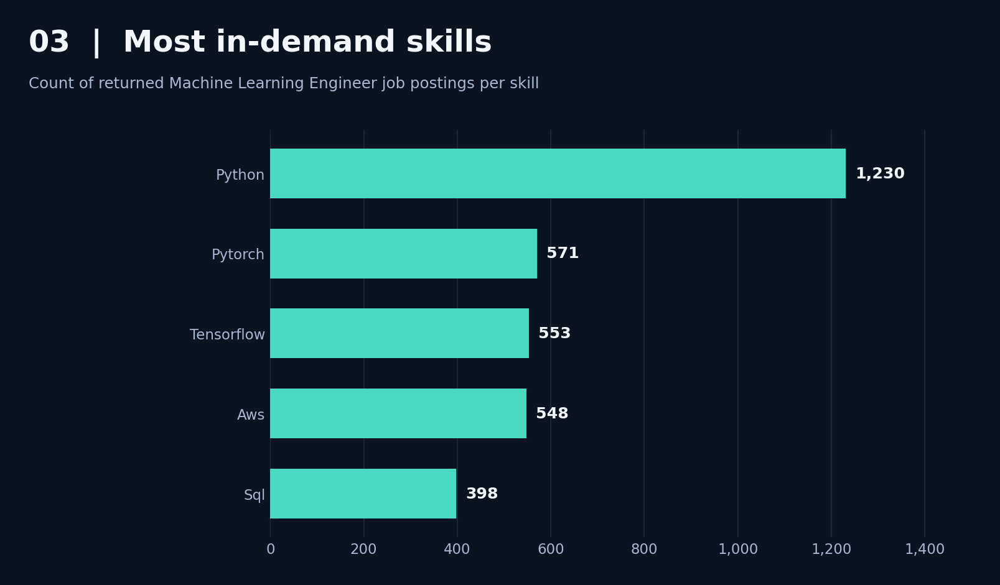
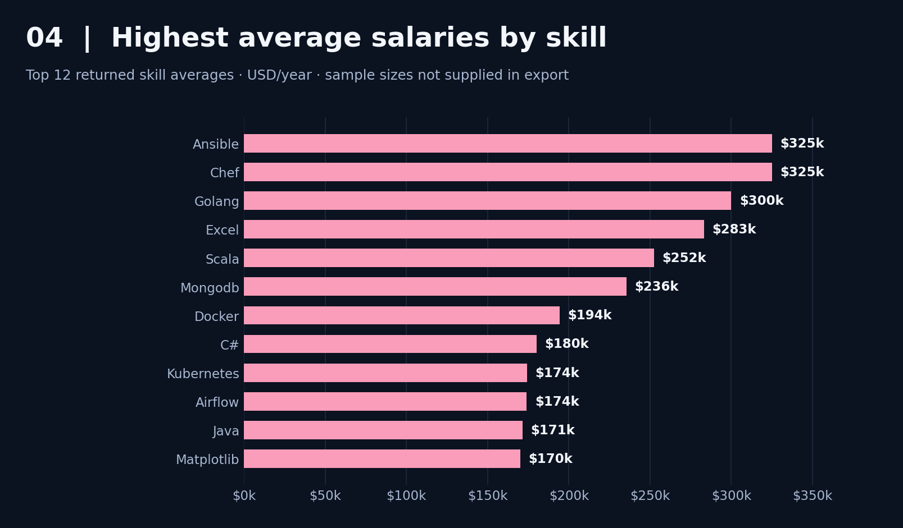
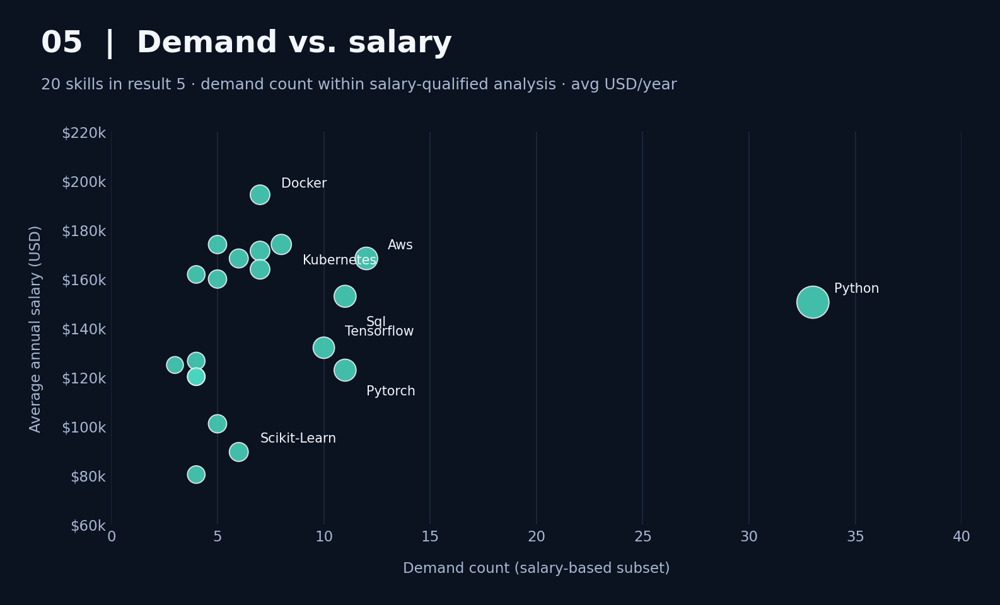

--readme
# Machine Learning Engineer Job Market Analysis | SQL

A SQL portfolio project exploring **2023 Machine Learning Engineering job postings**, advertised annual salaries, and in-demand technical skills.

> **Scope:** Findings describe the filtered job postings returned by this dataset and these SQL queries—not the current job market or guaranteed salary outcomes. This project was completed while following **Luke Barousse’s SQL for Data Analytics** course.

## Introduction

Which technical skills are most useful to prioritize for a Machine Learning Engineering career? This project uses PostgreSQL to examine job posting compensation, technologies required for highly paid roles, and the relationship between demand and advertised salary.

The investigation is organized around five SQL analyses and their exported results.

## Background

I built this project as part of my transition into AI Engineering. I wanted to use real job-posting data to answer practical questions:

1. Which returned Machine Learning Engineering roles offer the highest salaries?
2. Which skills appear in those high-paying job postings?
3. Which skills appear most often in the selected job listings?
4. Which skills are associated with higher average advertised salaries?
5. How does salary compare with skill demand in a salary-filtered subset?

**Data:** 2023 job-posting records from the dataset used in Luke Barousse’s SQL course. The project queries the `job_postings_fact`, `company_dim`, `skills_job_dim`, and `skills_dim` tables. The exports used for the charts are listed in the [Analysis](#the-analysis) section.

## Tools I Used

- **PostgreSQL:** Relational database and SQL query engine.
- **SQL:** Joins, filtering, aggregation, CTEs, and ranking results.
- **VS Code:** Writing and running SQL files.
- **Git & GitHub:** Version control and project publication.
- **Python / Matplotlib:** Generated the visualizations from exported SQL results for documentation.

## The Analysis

### 1. Top-Paying Machine Learning Engineer Jobs

The first query returns **10 high-paying job postings** located in **Anywhere**, with reported average annual salaries. Two of the returned postings have advertised annual salaries of **$325,000** (Harnham and Storm5); the next is **$300,000** (orbit).

*Chart: Annual salaries of the ten returned postings (2023). The role names reflect the job titles in the export, including senior, principal, researcher, and director-level roles.*

### 2. Skills Associated with High-Paying Jobs

The second query joins high-paying job postings to their listed skills. This chart counts **distinct job IDs per skill** from that export, so a skill duplicated for a single job is not counted twice. Python and cloud/infrastructure tooling appear across the sample.

*Chart: Number of distinct job postings containing each skill in the second export. This is a small selected sample, not a market-wide frequency estimate.*

### 3. Most In-Demand Skills

For the third analysis, **Python** leads with **1,230** occurrences in the returned job-posting counts, followed by **PyTorch (571)**, **TensorFlow (553)**, **AWS (548)**, and **SQL (398)**.

*Chart: Demand counts from the third SQL export. Counts can differ from the salary-based analysis because the underlying query filters differ.*

### 4. Top-Paying Skills

The fourth analysis ranks skills by **average advertised annual salary** among the qualifying postings. The highest returned values include **Ansible ($325,000)**, **Chef ($325,000)**, and **Golang ($300,000)**.

*Chart: The top 12 of 30 returned skill-level averages. **Caution:** This export contains no observation-count column, so these averages may be based on very few postings and should not be treated as reliable estimates of a skill’s market value.*

### 5. Optimal Skills: Demand vs. Salary

The final analysis compares **demand count** with **average advertised salary** for 20 returned skills. In this subset, **Python** appears **33** times at an average of **$150,570.24**, compared with **AWS** at **12** and **$168,401.50**, and **Docker** at **7** and **$194,331.14**.

*Chart: Each dot represents a skill; the horizontal position indicates demand count and the vertical position indicates average salary. Larger dots also indicate higher demand. **These demand counts use the salary-qualified subset**, so they must not be compared directly to the counts in Analysis 3.*

## What I Learned

This project helped me practice writing multi-table queries, connecting job postings to skills, calculating grouped metrics such as `COUNT()` and `AVG()`, organizing multi-step logic with CTEs, and interpreting query results rather than treating the output as just numbers.

I also practiced the practical development workflow: keeping SQL scripts in a repository, creating commits, synchronizing with GitHub, and documenting results with charts in a `README.md` file.

## Conclusions

- **Python is highly represented** in the demand results and remains a sensible foundation for ML Engineering study.
- **Frameworks and infrastructure both matter:** PyTorch, TensorFlow, AWS, SQL, and deployment-related tools appear in the returned analyses.
- **High average salary is not the same as high demand:** skills with large averages may appear in very few salary-reporting postings.
- **The analysis has important limits:** this is historical 2023 job-posting data; advertised salaries may be missing or inconsistent; queries can use different filters; and observed associations do not prove a skill causes higher pay.

**Career takeaway:** These results support studying Python and machine learning alongside databases and software/infrastructure fundamentals—but they do not establish a definitive ranking of the best skills for every learner.

---

### How to Reproduce

1. Import the Luke Barousse job-postings dataset into PostgreSQL using the four tables listed in [Background](#background).
2. Open the project’s `.sql` scripts in VS Code (or another PostgreSQL SQL editor).
3. Connect to the database, run each analysis, and export the result rows as CSV.
4. Review the charts in the `images/` folder, which were generated from the five exported result datasets.